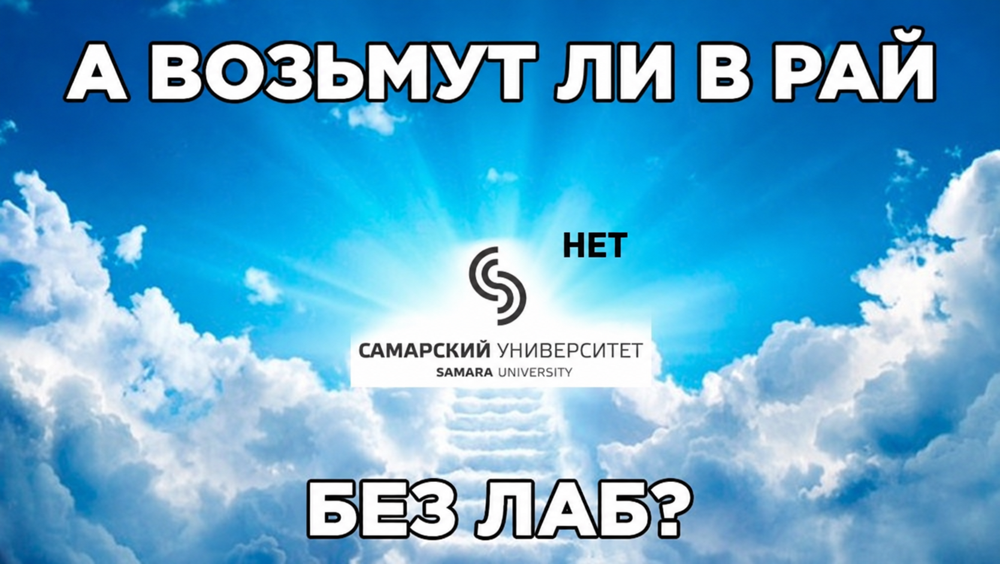

## Лабораторная работа №1

**ФИО:**
Постникова Светлана Вячеславовна

**Группа:**
6403-010302D

**Научный руководитель:**
Гошин Егор Вячеславович

**Цитата:** «Удача благоволит смелым»

## Лабораторная работа №2

«Beads For You» — магазин изделий из бисера и бусин на заказ моей сестры.

Файлы проекта:

- `index.html` — главная страница: об авторе, чем занимается мастер, ссылки на соцсети.
- `premium.html` — Premium-подписка: возможности и бесплатные мастер-классы.
- `order.html` — заказ украшений: примеры работ и таблица полезных ссылок.
- `css/style.css` — файл стилей.
- `img/` — изображения (логотип и фотографии работ).

## Лабораторная работа №3
В ходе лабораторной работы изучена структура проекта и реализованы функции в файле src/core.js:
- Проверка целого числа и степени двойки.
- Формирование массива чётных чисел от 2 до 20.
- Вычисление суммы чисел с помощью цикла и рекурсии.
- Вычисление факториала и чисел Фибоначчи.
- Создание функции с сохранением результата операции.
- Создание генератора арифметической последовательности.
- Глубокое сравнение объектов и массивов.

## Лабораторная работа №4

Сайт «beads for you» доработан с помощью Flexbox, Grid, CSS-переменных и анимации. При отправке формы заказа создаётся объект класса `Order`, который выводит данные в консоль. Форма отправляет заявку на локальный сервер.

Для запуска выполните `python3 server.py` и откройте http://127.0.0.1:8000.
